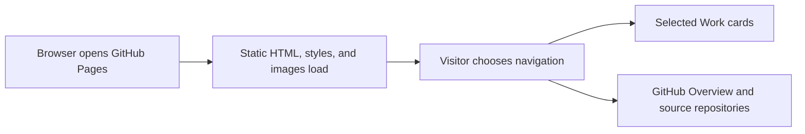

# lokesh-kalluru-portfolio

Senior SRE, DevOps, DevSecOps, platform engineering, and AI automation portfolio site for Lokesh Reddy.

## Local Preview

Open `index.html` in a browser, or run:

```bash
python3 -m http.server 4173
```

Then visit `http://127.0.0.1:4173`.

## Publish Options

- Project page repository: `lokesh-kalluru-portfolio`
- Netlify/Vercel static deploy from this folder

## Local verification

Run `make verify` with Make and Python 3 installed. The check validates local links, fragments, and asset paths in the portfolio HTML.

## Business problem

Recruiters and engineers need a direct route from the landing page to selected projects, source code, and verification evidence.

## Project walkthrough



[Architecture and data flow](docs/ARCHITECTURE.md) · [Business problem, demo, and verification](docs/CASE_STUDY.md)

## Run the project

### Local setup

Run `make verify` with Python 3 and Make installed.

### CLI usage

```sh
python3 verify_site.py
```

### Replay usage

Run `make replay` to replay the checked-in inputs. The runner compares stdout with the baseline, reports differences, and exits nonzero on regression.

[Replay cases](examples/replay-manifest.json) · [Generated report](reports/replay.md) · [Rule implementation](docs/RULES.md)

### Run tests

[Verification report](reports/verification.md) · [Business problem, sample behavior, and limitations](docs/CASE_STUDY.md)


### Limitations

The verification report covers the bundled local examples. See the [case study](docs/CASE_STUDY.md) for project-specific assumptions and operating limits.

## Development and security

See the [developer setup, tool roles, and security checks](docs/DEVELOPMENT.md).

[Local check results](reports/devsecops.md)

## Runbook

[Run, verify, and troubleshoot this project](docs/RUNBOOK.md)
