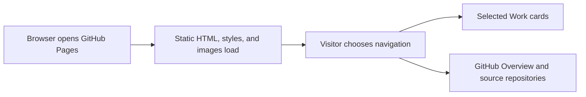

# Lokesh Kalluru Portfolio architecture

Give visitors an accessible route from the homepage to selected work and public source repositories.

## Operational boundaries

The local checker covers relative files, anchor targets, and duplicate IDs. External sites are outside the checker.
